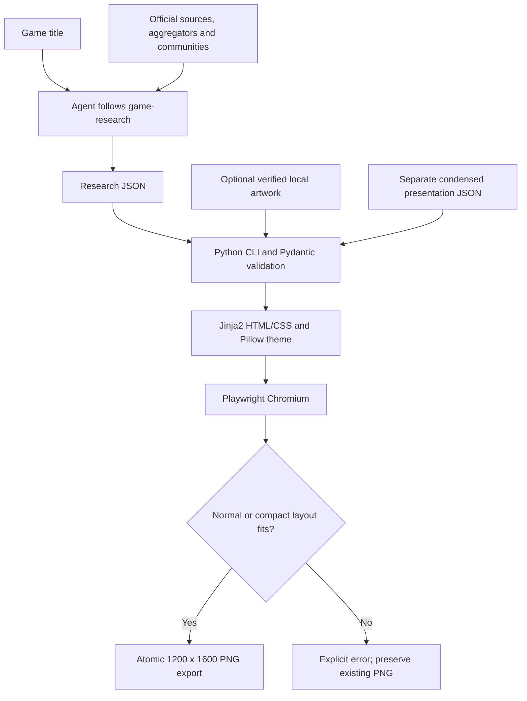

# Game Infographic Generator — current snapshot

Captured: **October 15, 2026, 22:47:36 America/Toronto (UTC−04:00)**.
Replaces the October 14 snapshot. Repository investigation followed
[repo-understanding](skills/repo-understanding/SKILL.md); documentation updates,
verification, and Git operations were separately requested by the user.

## 1. Purpose and current state

The single-game POC is working and its current results are accepted as the baseline
before further visual refinement. An agent researches a title and prepares local
inputs; Python validates them and renders a fixed **1200 × 1600 portrait PNG**.
Personal rankings remain planned, with no rankings command, model, or renderer.

Six games have saved research and artwork-mode infographics: Genshin Impact,
Stellar Blade, Yakuza: Like a Dragon, Clair Obscur: Expedition 33,
The Legend of Zelda: Ocarina of Time, and NieR:Automata. Recent images were
visually inspected during their generation runs; they were not regenerated tonight.

## 2. Components and dependencies

| Component | Responsibility |
| --- | --- |
| [AGENTS.md](AGENTS.md), [README.md](README.md) | Project guidance, setup, and usage |
| [game-research](skills/game-research/SKILL.md) | Research procedure and authoritative contract for intentional schema changes |
| [models.py](src/game_infographic_generator/models.py) | Strict runtime GameMetadata validation and nested critic, sentiment, and source models |
| [cli.py](src/game_infographic_generator/cli.py) | Readiness, validate, and single-game commands |
| [single_game.py](src/game_infographic_generator/rendering/single_game.py) | HTML assembly, browser capture, fit checks, and atomic publishing |
| [presentation.py](src/game_infographic_generator/rendering/presentation.py) | Separate artwork-mode overview and sentiment copy validation |
| [theme.py](src/game_infographic_generator/rendering/theme.py) | Image decoding and deterministic contrast-checked accent selection |
| [templates](src/game_infographic_generator/rendering/templates/) | Reusable editorial HTML/CSS |
| [infographic-design](skills/infographic-design/SKILL.md) | Design constraints, artwork selection, and visual verification |
| [repo-understanding](skills/repo-understanding/SKILL.md), [change-planner](skills/change-planner/SKILL.md) | Independent read-only investigation helpers |
| [architecture-visualizer](skills/architecture-visualizer/SKILL.md) | Independent read-only architecture investigation returning Mermaid diagrams |
| [tests](tests/) | Metadata, CLI, template, theme, and Chromium integration checks |
| [tools/mermaid](tools/mermaid/) | Optional Mermaid CLI development dependency and npm lockfile |

The Python application uses Python 3.11+, Pydantic 2, Jinja2, Playwright Chromium,
and Pillow, with pytest for development. Editable installation and packaged templates
are configured in [pyproject.toml](pyproject.toml).

Optional Mermaid CLI 12.0.0 uses Node 22 (tested: 22.23.3) and Puppeteer. It is
separate from the Python application. This workspace has an ignored local Node
runtime at `.tools/node/`; package manifests and lockfile record the development
tool dependency. A real SVG smoke export succeeded during setup. Fresh checkouts
need Node/npm and `npm --prefix tools/mermaid ci`; see README.

## 3. Architecture and data flow



Agent-driven artwork discovery and condensation are separate from Python. The CLI
does not search, download, identify games in images, establish permissions, or
summarize text. Artwork provenance is saved separately from metadata.

Runtime models reject unexpected fields and implicit scalar coercions. Only title
is required on load; optional scalars default to null and lists to empty arrays.
Research output must nevertheless include every top-level field. Original-language
titles are verified, and the date defaults to the earliest full official release
of the specified edition across regions/platforms. Opened sources must be checked
for edition, platform, and release year before taking metadata or scores.

Typography-only mode displays full metadata text except sources. Artwork mode
requires `--artwork` plus `--presentation`, using a one-sentence overview and short
Highlights/Criticisms while retaining factual metadata and similar games. Research
JSON remains unchanged. Sources remain there and are omitted from the PNG.

The editorial layout has a dominant title and alternative title, a full-width
16:9 artwork hero when requested, approximately 2:1 metadata/score columns, and
subtle contrasting sentiment panels. Neutrals stay consistent; artwork provides
a deterministic accent with a fixed fallback and at least 4.5:1 contrast for the
accent/background and card text. No manual accent option is exposed.

The browser waits for fonts/images and blocks network requests. It tries normal
then compact spacing and fails on unresolved overflow, never dropping requested
artwork or truncating content. Successful PNGs are verified before atomic replacement.

### Artifact locations

- [game-research/](data/validation-runs/game-research/): six research JSON examples.
- [infographic-design/](data/validation-runs/infographic-design/): PNG iterations,
  separate presentation copy, and an optional NieR validation report.
- [assets/artwork/](assets/artwork/): local images and source/usage provenance.
- Filenames retain game slug, Toronto timestamp with UTC offset, and tested skill.
  Examples are grouped by stage, without game or timestamp subdirectories.

### Useful commands

```sh
source .venv/bin/activate
python -m pytest
game-infographic-generator validate tests/fixtures/game_metadata.json
game-infographic-generator single-game metadata.json output.png
game-infographic-generator single-game metadata.json output.png \
  --artwork image.jpg --presentation presentation.json
```

The last commands use caller-supplied input paths; README has an existing-file example.
To get an architectural refresher, ask: “Use architecture-visualizer to diagram
this repository.” Diagram text is returned by default; file export is separate.

## 4. Quality, gaps, and risks

Final pre-commit verification tonight: **75 tests passed in 12.22 seconds**, including
real Chromium checks. Coverage includes strict metadata and skill-example contracts,
CLI dispatch and invalid inputs, escaping, Unicode, sparse content, color contrast,
PNG dimensions, compact fallback, overflow failure, and existing-output preservation.

Ocarina of Time exposed an intrinsic image-size bug: portrait artwork expanded the
hero beyond 16:9. CSS now positions the image within the frame; portrait and landscape
regression tests verify the frame in both normal and compact layouts. Existing
square artwork fixtures are also exercised. The design skill explicitly calls
for portrait/square/landscape checks and final crop/upscaling inspection.

NieR:Automata completed research, validation, and artwork export without further
implementation changes. Its optional [validation report](data/validation-runs/infographic-design/nier_automata__2026-10-15T220607-0400__infographic-design.validation.md)
records research scope, checks, contrast values, and limitations. Saved validation
reports are discretionary, not a required repeatable skill output.

Known limits:

- Research accuracy, edition matching, artwork selection/permissions, semantic
  condensation, and editorial similar-game choices still require judgment.
- Player sentiment comes from limited qualitative samples, not representative consensus.
- Large records can still exceed the fixed canvas; the intended behavior is explicit failure.
- Local fonts and dependency versions can change wrapping and colors between machines.
- Some official artwork is low resolution; the Ocarina example is visibly softer.
- The skill-creator validator could not run because PyYAML was unavailable. The new
  architecture skill was manually reviewed; no extra Python dependency was added.

## 5. Unknowns and next steps

The agreed next direction is visual refinement against the preserved baseline
examples. Rankings and automated title-to-PNG orchestration are future decisions;
no implementation has started for either. Font bundling and stronger research
provenance may be considered if reproducibility becomes a priority.

This snapshot covers the local working tree prepared for the requested commit.
The earlier examples were moved, not deleted. Local runtimes, dependencies,
caches, and secrets remain ignored. Commit/push results are reported separately
when those operations complete; no future Git outcome is assumed here.

Inspection covered guidance, skills, docs, config, implementation, tests, artifact
inventory, and Git changes. Source facts and artwork permissions were not re-audited
online tonight, and a clean-machine installation was not tested.
